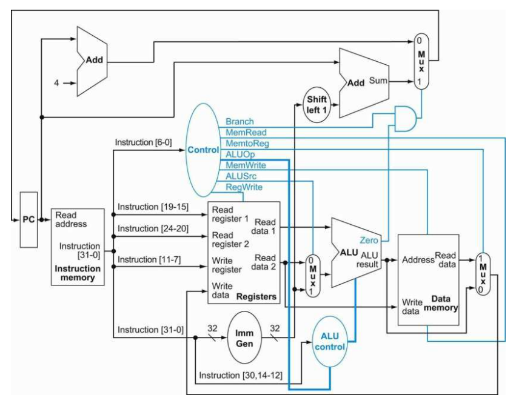
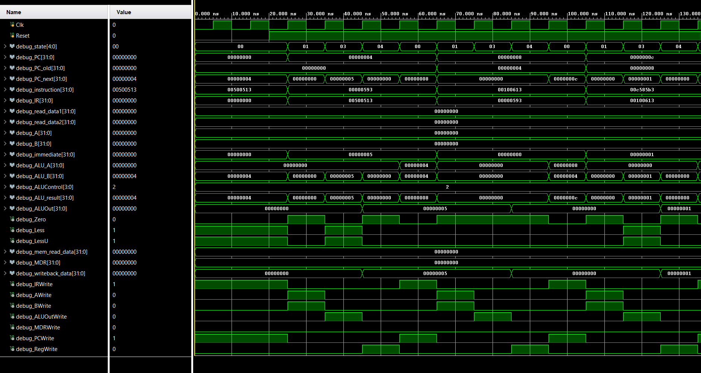

# Multi-Cycle RISC-V Processor (RV32I)

A modular **32-bit multi-cycle RISC-V processor** implemented in Verilog HDL, supporting the **RV32I base integer instruction set**. The processor divides instruction execution into multiple clock cycles using an **FSM-based control unit**, allowing datapath resources such as the ALU to be reused across different instruction types.

---

## Microarchitecture



---

## Supported Instructions

| Type                | Instructions                                         |
| ------------------- | ---------------------------------------------------- |
| **R-type**          | ADD, SUB, AND, OR, XOR, SLL, SRL, SRA, SLT, SLTU     |
| **I-type (ALU)**    | ADDI, ANDI, ORI, XORI, SLTI, SLTIU, SLLI, SRLI, SRAI |
| **I-type (Load)**   | LB, LH, LW, LBU, LHU                                 |
| **S-type (Store)**  | SB, SH, SW                                           |
| **B-type (Branch)** | BEQ, BNE, BLT, BGE, BLTU, BGEU                       |
| **U-type**          | LUI, AUIPC                                           |
| **J-type**          | JAL, JALR                                            |

---

## Project Structure

```text
RISC_V_Multi_Cycle/
│
├── architecture/
│   └── RV32I.png
│
├── rtl/
│   ├── ALU.v
│   ├── ALU_control_unit.v
│   ├── PC.v
│   ├── data.mem
│   ├── data_memory.v
│   ├── imm_gen.v
│   ├── instruction_mem.v
│   ├── multicycle_controller.v
│   ├── processor.v
│   ├── program.mem
│   └── register_file.v
│
├── simulation/
│   └── tb_processor.v
│
├── waveform/
│   └── waveform_sum.png
│
├── LICENSE
└── README.md
```

---

## How It Works

Unlike a single-cycle processor, each instruction is executed over multiple clock cycles. The processor uses temporary registers to hold intermediate values between states.

1. **Fetch** — The Program Counter addresses instruction memory. The instruction is loaded into the Instruction Register, while `PC + 4` is calculated.

2. **Decode** — The instruction fields are decoded and the register file reads `rs1` and `rs2`. The values are stored in temporary `A` and `B` registers.

3. **Execute** — The ALU performs the required arithmetic, logical, comparison, address-generation, or control-flow calculation.

4. **Memory Access** — Load and store instructions calculate their effective address and access the byte-addressable data memory.

5. **Write-Back** — The result is written to the destination register from either:

   * `ALUOut`
   * `MDR`
   * `PC + 4` for `JAL` and `JALR`


---

## Control Path

The processor uses an **FSM-based multi-cycle controller** to generate the control signals required for each execution state.

### Multi-Cycle Controller

The controller generates:

```text
IRWrite
AWrite
BWrite
ALUOutWrite
MDRWrite

PCWrite
RegWrite

MemRead
MemWrite

ALUSrcA
ALUSrcB
ALUOp

PCSource
WriteBackSel
```

The main execution states include:

```text
FETCH
DECODE

EXEC_R
EXEC_I
WB_ALU

MEM_ADDR
MEM_READ
MEM_WRITE
WB_LOAD

BRANCH_TARGET
BRANCH_COMPARE

JAL_CALC
JAL_WRITE

JALR_CALC
JALR_WRITE

LUI
AUIPC
```

Each instruction follows a different sequence of states depending on its instruction type.

### ALU Control Unit

The ALU Control Unit uses `ALUOp`, `funct3`, and `instruction[30]` to generate the exact ALU operation.

For example:

```text
funct3 = 000, instruction[30] = 0 → ADD
funct3 = 000, instruction[30] = 1 → SUB

funct3 = 101, instruction[30] = 0 → SRL
funct3 = 101, instruction[30] = 1 → SRA
```

---

## Branch and Jump Logic

### Conditional Branches

The processor supports all RV32I conditional branches:

```text
BEQ   BNE
BLT   BGE
BLTU  BGEU
```

Branch decisions use three comparison outputs from the ALU:

```text
Zero   → Equality comparison
Less   → Signed comparison
LessU  → Unsigned comparison
```

The branch target is calculated during a separate FSM state:

```text
Branch Target = PC_old + Immediate
```

### JAL

For a `JAL` instruction:

```text
Target Address = PC_old + Immediate
```

The processor writes `PC + 4` into the destination register.

### JALR

For a `JALR` instruction:

```text
Target Address = (rs1 + Immediate) & ~1
```

The least significant bit of the target address is cleared.

---

## Memory Access

The data memory is **byte-addressable** and contains **1 KB of memory**.

```text
Memory Size = 1024 Bytes
```

### Supported Loads

```text
LB    Load Byte (Signed)
LH    Load Halfword (Signed)
LW    Load Word
LBU   Load Byte (Unsigned)
LHU   Load Halfword (Unsigned)
```

### Supported Stores

```text
SB    Store Byte
SH    Store Halfword
SW    Store Word
```

Signed loads perform sign extension, while unsigned loads perform zero extension.

For word accesses, data is stored and reconstructed in little-endian byte order.

---

## Register File

The processor contains:

```text
32 Registers × 32 bits
```

Register `x0` is hardwired to zero:

```text
x0 = 0
```

The register file provides two source-register read ports and a destination-register write port.

During the Decode state:

```text
A = Register[rs1]
B = Register[rs2]
```

These values are retained for subsequent execution states.

---

## Multi-Cycle Datapath

The processor uses temporary registers to preserve intermediate results:

```text
IR      → Instruction Register
A       → Source Operand A
B       → Source Operand B
ALUOut  → ALU Result / Address
MDR     → Memory Read Data
```

The same ALU can therefore be reused for different operations.

For example:

```text
FETCH
    PC + 4

ALU EXECUTION
    Register Operation

MEMORY ADDRESS
    Base + Immediate

BRANCH TARGET
    PC_old + Immediate

JAL TARGET
    PC_old + Immediate

JALR TARGET
    Register + Immediate

AUIPC
    PC_old + Immediate
```

This hardware reuse is the primary advantage of the multi-cycle architecture.

---

## Simulation

The processor includes a dedicated testbench:

```text
tb_processor.v
```

The testbench generates the clock and reset signals and connects the processor's internal debug signals for waveform analysis.

The simulation exposes:

* FSM State
* Program Counter
* Instruction Register
* Register File Outputs
* A and B Registers
* Immediate Value
* ALU Inputs
* ALU Control
* ALU Result
* ALUOut
* Memory Data
* MDR
* Writeback Data
* PC Write
* Register Write
* Memory Read/Write
* MUX Control Signals

### Simulation Waveform



The waveform shows the processor executing the **sum of natural numbers** program across multiple FSM states.

---

## Program Used for Verification

The current `program.mem` contains:

```text
00500513
00000593
00100613
00c585b3
00160613
fec55ce3
0000006f
```

The program implements a loop for calculating the **sum of natural numbers** and is used to verify instruction execution, ALU operations, register updates, branch behavior, and repeated multi-cycle instruction execution.

---

## Multi-Cycle vs Single-Cycle

In a single-cycle processor, every instruction must complete all operations within one clock cycle.

In this design, instruction execution is divided into multiple states:

```text
FETCH
  ↓
DECODE
  ↓
EXECUTE
  ↓
MEMORY ACCESS
  ↓
WRITE-BACK
  ↓
FETCH
```

Different instructions require different numbers of clock cycles.

### Advantages

* Reuses datapath hardware
* Shorter combinational critical path
* FSM-based control simplifies instruction sequencing
* Supports different instruction classes using the same ALU
* Easier to extend with additional instruction types

### Limitation

Instructions require a variable number of clock cycles, so the **CPI is greater than one** and depends on the instruction being executed.


